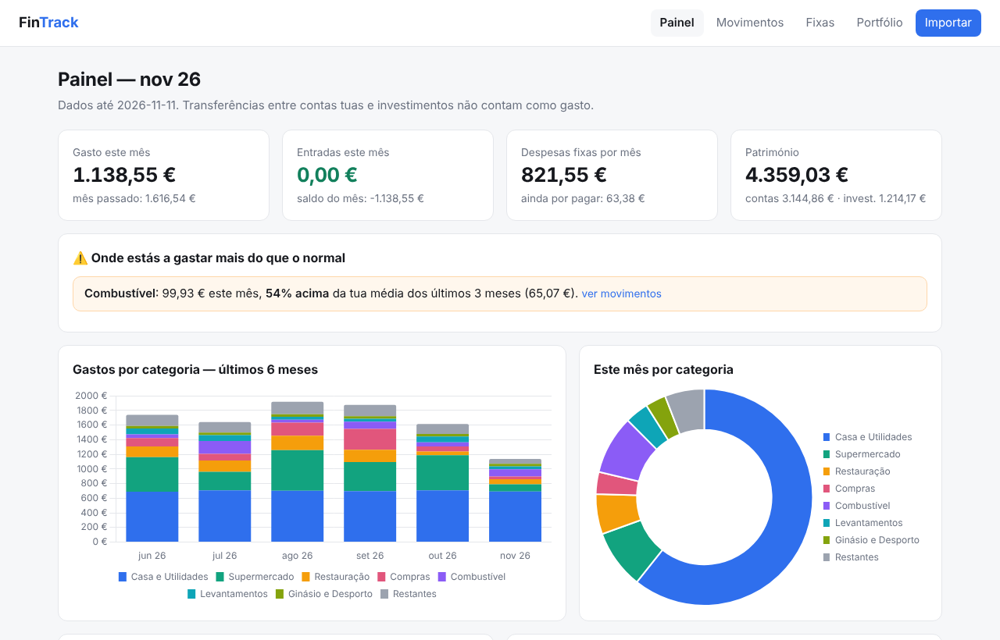

# FinTrack

App pessoal de finanças: junta **Revolut**, **ActivoBank** e **DEGIRO** num só sítio e mostra
onde gastas dinheiro, quais são as tuas despesas fixas e quanto vale o teu património.



Corre só no teu computador. Os dados ficam num ficheiro local (`data/fintrack.db`) e nunca
vão para o GitHub nem para nenhum servidor.

## O que faz (fase 1)

- **Importa extratos** em CSV/XLSX da Revolut, do ActivoBank (e outros bancos portugueses) e da DEGIRO.
  Deteta o formato sozinho e ignora movimentos repetidos, por isso podes importar períodos sobrepostos.
- **Categoriza** cada movimento (Supermercado, Restauração, Subscrições…). Se mudares uma categoria,
  a app aprende para esse comerciante.
- **Painel**: gasto do mês, comparação com meses anteriores, categorias, onde gastaste mais.
- **Alertas**: avisa quando uma categoria está acima da tua média dos últimos 3 meses.
- **Despesas fixas**: deteta pagamentos recorrentes (renda, Netflix, ginásio…), mostra o custo
  mensal/anual, o que ainda falta pagar este mês e as subscrições que deixaram de aparecer.
- **Portfólio**: ETFs da DEGIRO, valor, quanto investiste, ganho/perda e património total.

Transferências entre as tuas contas (ActivoBank → Revolut), câmbios e investimentos **não** contam como gasto.

## Instalar num servidor grátis (para usar no iPad/telemóvel)

Segue o guia **[docs/INSTALAR.md](docs/INSTALAR.md)**. Usa o Google Cloud (grátis) e a
Tailscale: a app fica acessível só nos teus aparelhos, com login de dois fatores e palavra-passe.

## Correr num computador

Precisas de Python 3.10 ou mais recente.

```bash
pip install -r requirements.txt
```

Para experimentar com dados fictícios:

```bash
python -m fintrack.demo
```

Arrancar a app e abrir http://localhost:8000:

```bash
python -m fintrack
```

Depois vai a **Importar** e escolhe os teus ficheiros.

### Onde exportar os extratos

| Fonte | Onde |
|---|---|
| Revolut | App → conta → ⋯ → Extrato → Excel/CSV |
| ActivoBank | Site → Contas → Movimentos → período → Exportar |
| DEGIRO (posições) | Site → Portfólio → Exportar → CSV |
| DEGIRO (compras, para calcular ganhos) | Site → Caixa → Transações → desde o início → Exportar → CSV |

Se um ficheiro não for reconhecido, a app diz-te. Manda um exemplo (com dados apagados) para
acrescentar suporte.

Para recomeçar do zero, apaga o ficheiro `data/fintrack.db`.

## Próximas fases

1. ~~Base: importar, categorizar, painel, despesas fixas, portfólio~~ ✅
2. Ligação automática aos bancos por Open Banking (PSD2), com sincronização diária
3. Categorização com IA para os movimentos que as regras não apanham
4. Orçamentos por categoria e notificações
5. Atualização automática das cotações dos ETFs

## Para quem programa

```
fintrack/
  importers/   # um módulo por formato (revolut, degiro, bank genérico)
  categories.py  # regras de categorização
  recurring.py   # deteção de despesas fixas
  analytics.py   # totais, alertas, portfólio
  db.py          # SQLite
  auth.py        # login (palavra-passe + cookie assinado)
  web/           # FastAPI + templates Jinja + Chart.js
deploy/          # instalação no servidor (systemd, Tailscale, atualizações, cópias)
tests/           # pytest (python -m pytest)
```
